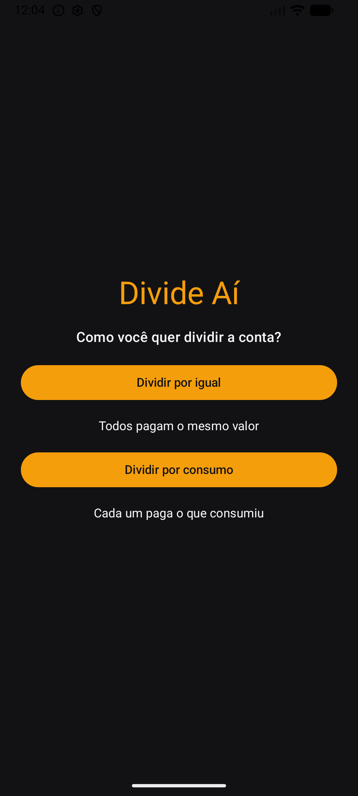
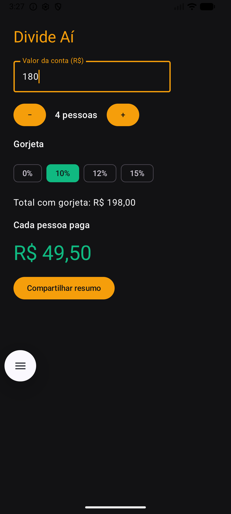
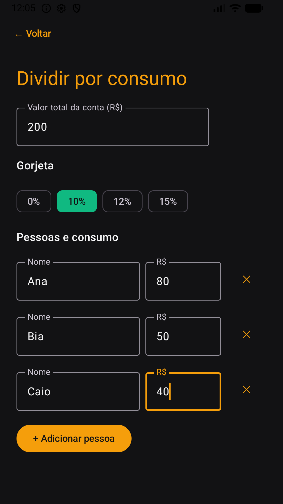
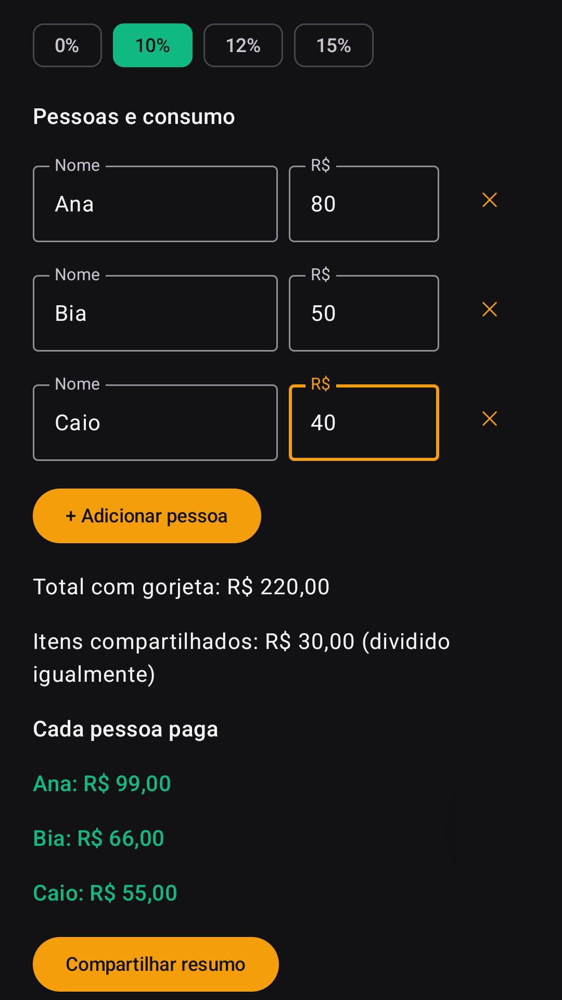

# Divide Aí

Aplicativo Android para dividir a conta do bar ou do churrasco entre amigos: por igual ou por consumo, com gorjeta e resumo pronto para enviar no WhatsApp.

  
  
  
  

## Funcionalidades

**Dividir por igual**
- Digite o valor da conta em reais (ex.: `180,50`)
- Escolha o número de pessoas (de 1 a 50)
- Selecione a gorjeta: 0%, 10%, 12% ou 15%
- Veja o total com gorjeta e quanto cada pessoa paga

**Dividir por consumo**
- Informe o total da conta e o que cada pessoa consumiu (com nome editável)
- Itens compartilhados (a diferença entre o total e a soma dos consumos) são divididos igualmente
- A gorjeta é proporcional ao valor de cada um
- Os centavos fecham exatamente com o total da conta

**Nos dois modos**
- Compartilhe o resumo por WhatsApp ou qualquer outro app
- Botão voltar para trocar de modo sem perder o que foi digitado

## Tecnologias

- Kotlin
- Jetpack Compose e Material 3
- ViewModel para guardar o estado ao girar a tela
- Testes unitários com JUnit

## Decisões técnicas

- **Dinheiro em centavos (`Long`)**: evita os erros de arredondamento de `Double`. A soma dos valores individuais sempre bate com o total da conta.
- **Lógica separada da interface**: os cálculos ficam em `Divisao.kt`, funções puras cobertas por testes (`DivisaoTest.kt`).
- **Tema escuro próprio**: paleta pensada para uso à noite, com contraste alto.
- **Sem internet e sem coleta de dados**: o app funciona 100% offline. Veja a [política de privacidade](PRIVACY.md).

## Como rodar

1. Clone o repositório: `git clone https://github.com/devdenisviana/divide-ai.git`
2. Abra a pasta no Android Studio.
3. Aguarde a sincronização do Gradle e rode no emulador ou no celular (Android 8.0 ou superior).

## Próximos passos

- Gorjeta personalizada e couvert
- Publicação na Google Play